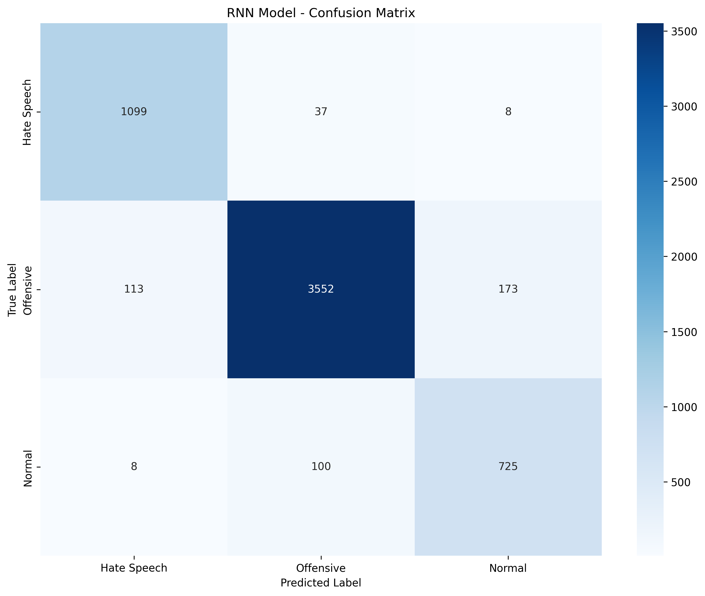
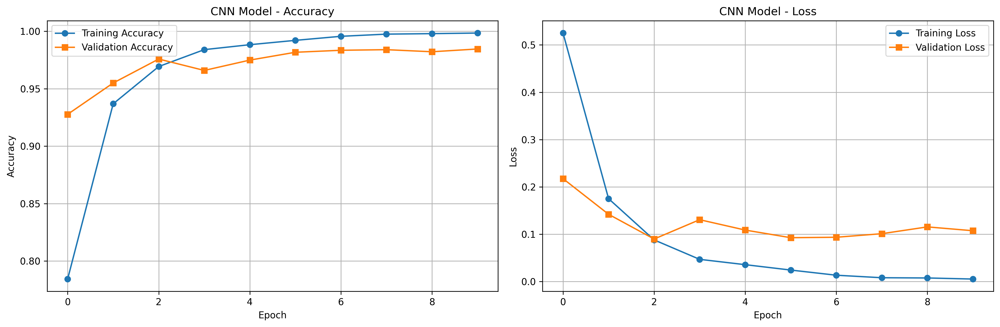
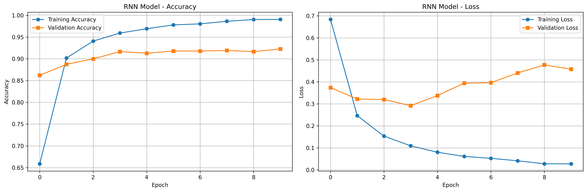

# Hate Speech Identification

A desktop application for training, testing, importing and exporting text
classifiers that label a piece of text as **hate speech**, **offensive
speech** or **normal speech**. It offers three model types behind one
interface: a CNN, a bidirectional LSTM (RNN), and a fine-tuned BERTweet
transformer.

Built as the final project for COSC 670 (Social Networks) at Towson
University, Fall 2025.

## Why

Plenty of hate speech models exist, but few tools let a non-technical user
train one and try it on their own text. This project wraps the whole loop
(pick a dataset, train, read the metrics, classify text) in a GUI that runs
on an ordinary laptop.

## Features

- **Train** a CNN, RNN or BERTweet model on a CSV dataset, with adjustable
  epochs, batch size and optional class weights.
- **Classify** any text with a trained model and see the predicted class.
- **Report** precision, recall, F1-score and support for each trained model.
- **Plot** training history and a confusion matrix.
- **Export and import** trained models, so a model trained once can be reused.

## Models

| Model | Approach | Trade-off |
|---|---|---|
| CNN | Embedding + 1D convolutions | Fastest to train; keys heavily on specific words and phrases |
| RNN | Embedding + bidirectional LSTM | Uses word order; slower than the CNN |
| BERTweet | Pre-trained tweet transformer, fine-tuned | Best results in testing; needs far more time and memory |

Example output from training runs:

| CNN | RNN |
|---|---|
|  |  |
|  |  |

## Running it

Requires Python 3.9 to 3.13.

```bash
pip install -r requirements.txt
python test_setup.py                      # checks the dependencies
python EvanDiglesCOSC670FinalProject.py   # opens the application
```

No dataset ships with this repository; see [Datasets/README.md](Datasets/README.md)
for the expected format. The first BERTweet run downloads the pre-trained
model (about 500 MB) from Hugging Face.

Suggested settings: 10 to 20 epochs at batch size 32 for the CNN and RNN;
2 to 3 epochs at batch size 8 to 16 for BERTweet.

## Project structure

```
EvanDiglesCOSC670FinalProject.py   GUI application (entry point)
test_setup.py                      dependency check
DataPreprocessing/                 text cleaning, tokenizing, train/test split
ModelBuilders/                     CNN, RNN and BERTweet model classes
RebalanceScript/                   oversampling script for the hate speech class
Datasets/                          put your CSV here (not included)
SavedModels/                       exported models (not included)
Plots/                             example training plots
```

## Limitations

- The source data had few hate speech examples, so that class was
  oversampled by a factor of four. Reported accuracy on the rebalanced data
  may overstate real-world accuracy.
- The CNN and RNN preprocessing strips digits and special characters, so
  obfuscated spellings go undetected by those two models.
- The application does not stop a user from training with too few epochs
  or from using a poor model.

## Use of AI

This project was built with AI assistance, as the course encouraged. The
approximate share of AI-generated or internet-sourced code, by raw line
count and estimated by hand:

| File | Share | Note |
|---|---|---|
| `EvanDiglesCOSC670FinalProject.py` | ~80% | Mostly GUI code; the important parts were fixed by hand |
| `data_preprocessing.py` | ~89% | Includes code from online sources |
| `models_bertweet.py` | ~51% | Much of the rest follows the Hugging Face model page |
| `models_rnn.py` | ~47% | The generated version did not actually use an LSTM; fixed by hand |
| `models_cnn.py` | ~36% | Mostly restructuring and printing code |
| `rebalance_dataset.py` | >90% | Reviewed; simple oversampling |

The design, model selection, debugging, evaluation and report are my own.

## Reference

Mathew, B., Saha, P., Yimam, S. M., Biemann, C., Goyal, P. and Mukherjee, A.
2021. HateXplain: A Benchmark Dataset for Explainable Hate Speech Detection.
*Proceedings of the AAAI Conference on Artificial Intelligence*, 35(17),
14867-14875.

## About this README

This README was rewritten with Claude for the portfolio copy of the
project. The code and its comments are as submitted for the course.
